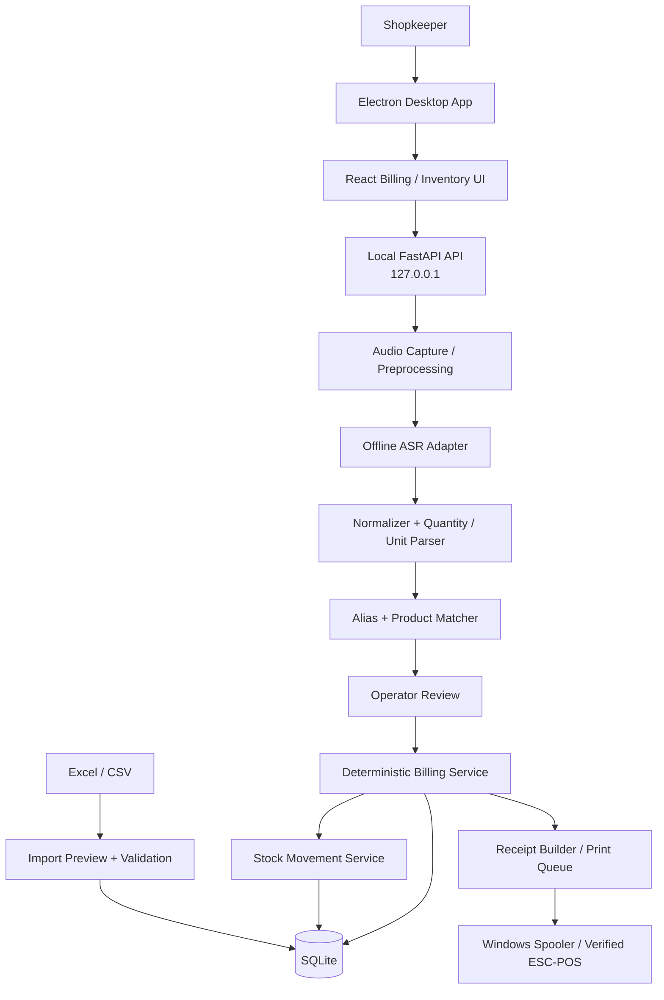

# VoiceGroceryPOS (SmartVoice POS)

Offline-first, voice-assisted grocery billing and inventory management for a single Windows counter.

> **Status:** Active development. Product catalogue, inventory import, sales/payment persistence, checkout API, stock/sales/report screens, and an optional local speech-recognition adapter are implemented. Voice-model installation, thermal printer validation, refund workflow, Windows packaging, and full end-to-end verification remain in progress.

## Overview

VoiceGroceryPOS is designed to let a grocery counter operator create a proposed bill by speaking product names and quantities in Punjabi, Hindi, English, or mixed speech. Audio is processed locally. The application transcribes speech, extracts product names/quantities/units, resolves items against the store's inventory, validates price and stock, calculates the bill deterministically, and prints only after operator confirmation.

The first release is a controlled pilot using 10–15 illustrative sample products. It must pass functional and accuracy tests before any real store inventory is imported.

## Goals

- Windows desktop application; one store and one counter initially.
- Offline operation for normal billing, speech processing, inventory, and printing.
- Push-to-talk voice capture.
- Punjabi + Hindi + English mixed-speech support, measured on real evaluation samples.
- Excel/CSV inventory import with column mapping, validation, preview, and explicit stock update modes.
- Deterministic prices, unit conversion, stock validation, and billing.
- Operator confirmation before sale commit.
- Thermal receipt printing, print retry, and reprint support.
- Local database, audit history, backup/restore, and Windows installer.

## Non-goals for the pilot

- Multi-store SaaS or multi-counter synchronization.
- Cloud ASR or cloud database dependency.
- Payment gateway integration.
- Unattended auto-checkout.
- Demand prediction and advanced analytics.
- Barcode integration (future enhancement).

## Finalized technology stack

| Layer | Technology | Responsibility |
|---|---|---|
| Desktop shell | Electron | Windows app lifecycle and secure process management |
| Frontend | React + Vite | Billing and inventory UI |
| Styling | Tailwind CSS | UI styling |
| Backend | Python 3.11+ + FastAPI/Uvicorn | Local APIs and application services |
| Validation | Pydantic | Request/response schemas |
| Database | SQLite | Local persistent store |
| ORM/migrations | SQLAlchemy 2.x + Alembic | Data access and schema evolution |
| ASR | Replaceable offline adapter | Punjabi/Hindi/English transcription |
| ASR candidates | Whisper multilingual Small; AI4Bharat Indic-Transcribe; optional IndicConformer comparison | Benchmark before final selection |
| NLP | Custom deterministic Python parser | Numbers, fractions, units, product phrases, commands |
| Product matching | Exact aliases + normalization + RapidFuzz | Catalog product resolution |
| Excel | Pandas + OpenPyXL | XLSX/CSV import/export |
| Money | Python Decimal; integer paise for persisted totals | Financial correctness |
| Printing | Windows spooler first; ESC/POS adapter after hardware verification | Receipt printing |
| Packaging | PyInstaller + Electron Builder | Offline Windows installer |
| Version control | Git + GitHub | Source control and collaboration |

**ASR model is not locked yet.** The selected model must be benchmarked on the actual target PC for Punjabi/Hindi/English code-mixing, word error rate, product-name accuracy, quantity accuracy, latency, CPU/RAM use, offline runtime, installer size, and redistribution license. Do not assume a model is accurate or deployable before testing.

## Architecture



### Responsibility boundaries

- ASR produces transcript; it never changes inventory.
- NLP extracts candidate items, quantities, units, and commands; it never chooses a price.
- Product matcher resolves to product IDs from the local catalog.
- Ambiguous, low-confidence, inactive, or unavailable items require operator action.
- Backend retrieves authoritative prices and stock from SQLite.
- Billing uses Decimal and explicit unit conversions.
- Sale, invoice snapshots, payment, stock movements, and stock balance changes are committed atomically.
- Printing occurs after sale commit; print failure does not undo the sale.
- Reprinting never deducts stock again.

## Initial runtime

- FastAPI binds to loopback only: `127.0.0.1`.
- Electron manages the backend process in production.
- SQLite is the source of truth.
- Normal operation requires no internet.
- Customer data lives outside the installation directory, e.g. under `%ProgramData%\VoiceGroceryPOS\`.
- Source code and documentation live in GitHub; customer inventory, invoices, audio, and database do not.

## Main workflows

### 1. Inventory import

1. Upload XLSX/CSV.
2. Select worksheet and map columns.
3. Validate required fields, duplicate SKUs, prices, quantities, units, and conversion factors.
4. Preview new, updated, unchanged, and conflicting rows.
5. Choose explicit mode: **replace stock count** or **add incoming stock**.
6. Confirm and commit in a transaction.
7. Save import batch and row-level results.

Missing rows never delete products. Existing rows are matched by SKU, not fuzzy product name. Price changes are recorded. Stock changes create stock movements.

### 2. Voice-to-cart

1. Press/hold microphone.
2. Capture audio locally; release/stop to finish.
3. Run local ASR.
4. Normalize text and parse product phrases, quantities, fractions, and units.
5. Resolve aliases and catalog candidates.
6. Show transcript and matches for review.
7. Add approved products to the uncommitted cart.

### 3. Checkout

1. Backend reloads current price and stock.
2. Validate unit conversion and available stock.
3. Calculate subtotal, discounts, configured tax, and grand total.
4. Display preview.
5. Operator confirms payment method and checkout.
6. Backend revalidates and atomically writes sale, invoice snapshots, payment, and stock movements.
7. Queue receipt printing after commit.

### 4. Cart corrections

Initial supported intents: add item, remove item, change quantity, clear cart (with confirmation), show total, and request checkout/print. Cart corrections never modify inventory before sale commit.

## Logical database schema

| Table | Purpose / key fields |
|---|---|
| `categories` | id, name, parent_id |
| `products` | id, sku, name, brand, category_id, selling_price, cost_price, stock_quantity, stock_unit, sale_unit, conversion factor, barcode, tax_rate, reorder_level, is_active |
| `product_aliases` | id, product_id, alias, normalized_alias, language |
| `sales` | id, invoice_number, idempotency_key, status, subtotal, discount, tax, grand_total, timestamps |
| `sale_items` | id, sale_id, product_id, name/sku/unit/price/tax snapshots, quantity, line_total |
| `payments` | id, sale_id, method, amount, reference, status |
| `stock_movements` | id, product_id, quantity_delta, movement_type, reference, note, timestamp |
| `price_history` | id, product_id, old_price, new_price, source, changed_at |
| `inventory_imports` | id, filename, file_hash, worksheet, stock_mode, status, row counts |
| `inventory_import_rows` | id, import_id, row_number, SKU, status, message |
| `print_jobs` | id, sale_id, printer_name, status, attempts, last_error |
| `audit_logs` | id, actor, action, entity_type, entity_id, details, timestamp |
| `app_settings` | key, value, updated_at |

### Data integrity rules

- Use Python Decimal for calculations; store money as integer paise where practical.
- Never use binary float for money.
- Store quantities with decimal precision.
- Distinguish stock unit from sale unit; only configured conversion factors are allowed.
- A packet is not converted to grams unless its pack size is configured.
- Every stock change creates a stock movement in the same transaction.
- Invoice snapshots remain unchanged after catalog edits.
- Sale confirmation uses a unique idempotency key.
- Enable SQLite foreign keys and use explicit transaction boundaries.
- Back up before imports and schema migrations; test restore.

## API outline

Versioned base path: `/api/v1`; local base URL uses loopback.

| Method | Endpoint | Purpose |
|---|---|---|
| GET | `/health` | Backend/database/model readiness |
| POST | `/voice/transcribe` | Audio to transcript |
| POST | `/voice/parse` | Transcript to structured intents |
| POST | `/voice/process` | Full local voice pipeline |
| GET/POST | `/products` | List/create products |
| GET/PATCH | `/products/{id}` | Read/update product |
| GET | `/products/search` | Catalog search |
| POST | `/products/{id}/aliases` | Add spoken alias |
| GET | `/inventory` | Stock listing |
| POST | `/inventory/import/preview` | Validate spreadsheet |
| POST | `/inventory/import/commit` | Commit approved import |
| POST | `/inventory/adjustments` | Manual stock adjustment |
| POST | `/cart/resolve` | Match parsed items |
| POST | `/sales/preview` | Validate and calculate bill preview |
| POST | `/sales/confirm` | Atomic sale commit |
| GET | `/sales` | Sales history |
| GET | `/sales/{id}` | Invoice details |
| POST | `/printing/jobs` | Queue/retry committed receipt |
| GET | `/printing/jobs/{id}` | Print job status |
| GET | `/reports/daily` | Daily sales |
| GET/PATCH | `/settings` | Local settings |

API must never trust client prices or totals. Confirmation must reload prices and stock, recalculate, and use an idempotency key. Preview does not reserve stock.

## Proposed repository structure

```text
VoiceGroceryPOS/
├── README.md
├── .gitignore
├── .editorconfig
├── docs/
│   ├── ARCHITECTURE.md
│   ├── DATABASE_SCHEMA.md
│   ├── API_SPECIFICATION.md
│   ├── VOICE_PIPELINE.md
│   ├── INVENTORY_IMPORT.md
│   ├── PRINTING.md
│   ├── SECURITY_AND_PRIVACY.md
│   ├── TESTING_STRATEGY.md
│   ├── DEPLOYMENT.md
│   ├── ROADMAP.md
│   └── DECISIONS.md
├── frontend/
│   ├── electron/
│   └── src/
│       ├── components/
│       ├── pages/
│       ├── services/
│       └── hooks/
├── backend/
│   ├── app/
│   │   ├── api/
│   │   ├── core/
│   │   ├── database/
│   │   ├── schemas/
│   │   ├── speech/
│   │   ├── nlp/
│   │   ├── matching/
│   │   ├── inventory/
│   │   ├── billing/
│   │   ├── printing/
│   │   └── services/
│   └── tests/
├── sample_data/
├── models/
├── scripts/
└── .github/workflows/
```

Directories are planned and will be added as implementation begins.

## Development roadmap

| Milestone | Scope | Exit criteria |
|---|---|---|
| M0 | Architecture and documentation | Decisions/contracts reviewed |
| M1 | FastAPI, SQLite, SQLAlchemy, migrations, 10–15 sample products | CRUD, constraints, migrations tested |
| M2 | Excel import and inventory dashboard | Preview, duplicate handling, stock modes, rollback tested |
| M3 | Manual cart and billing | Decimal, unit conversion, stock, transaction tests pass |
| M4 | Offline ASR benchmark | Candidate selected using target-PC results |
| M5 | Parser, aliases, matching, ambiguity | Evaluation corpus and safe confirmation pass |
| M6 | Voice-to-cart and correction commands | No unresolved match reaches checkout |
| M7 | Printer integration | Print/reprint without duplicate sale |
| M8 | Electron and Windows installer | Clean offline installation passes |
| M9 | Store pilot | Backup, real inventory import, operator sign-off |

## Pilot targets (not yet measured)

- Database price retrieval: 100%.
- Tested arithmetic: 100%.
- Stock transaction consistency: 100%.
- Quantity extraction target: >=99%.
- Product identification target: >=98%.
- No silent selection of ambiguous products.
- Normal billing functions offline.
- Printer failure is retryable without a duplicate sale.

ASR word error rate, end-to-end latency, RAM, CPU, speaker variation, and shop noise must be measured separately. Targets are not claims of current performance.

## Security and privacy

- Bind backend to loopback; no LAN exposure by default.
- Electron context isolation on, Node integration off, restricted preload API, CSP, validated IPC.
- No arbitrary shell commands from voice or UI text.
- Validate spreadsheet file type, size, cells, and structure; never run macros.
- Audio stays local and is deleted after processing by default.
- No cloud ASR/database/telemetry in normal operation.
- Keep customer DB, invoices, audio, and backups out of Git.
- Use audit logs and tested backups.
- App updates must preserve customer data and back up before migrations.

## Windows packaging

- Build Vite frontend.
- Package Python backend using PyInstaller.
- Package Electron using Electron Builder.
- Bundle only ASR models whose license permits redistribution.
- Store customer data under a writable application-data directory outside Program Files.
- Installer must preserve DB and settings on upgrade.
- Customer should not need Python, Node.js, VS Code, or internet for normal use.
- Test on a clean Windows PC with no developer tools installed.

## Development requirements

- Windows 10/11 64-bit.
- Python 3.11+ (pin exact validated version).
- Node.js LTS (pin exact major).
- Git and VS Code.

Implementation commands and runtime files will be added in M1. Keep frontend/backend environments separate.

## Documentation

- [Architecture](docs/ARCHITECTURE.md)
- [Database schema](docs/DATABASE_SCHEMA.md)
- [API specification](docs/API_SPECIFICATION.md)
- [Voice pipeline](docs/VOICE_PIPELINE.md)
- [Inventory import](docs/INVENTORY_IMPORT.md)
- [Printing](docs/PRINTING.md)
- [Security and privacy](docs/SECURITY_AND_PRIVACY.md)
- [Testing strategy](docs/TESTING_STRATEGY.md)
- [Deployment](docs/DEPLOYMENT.md)
- [Roadmap](docs/ROADMAP.md)
- [Architecture decisions](docs/DECISIONS.md)

## Current status

- [x] Requirements and scope documented
- [x] Proposed architecture and stack documented
- [x] Logical database and API contracts documented
- [x] Pilot plan and acceptance targets documented
- [x] Initial Electron + React application scaffold
- [x] Product catalogue CRUD/search and stock movement API
- [ ] Sample inventory workbook and validated Excel import
- [ ] Manual billing
- [ ] Offline voice pipeline
- [ ] Printer validation
- [ ] Windows installer

**Current implementation:** The repository now contains the M1 backend foundation, initial Electron/React workspace, product catalogue endpoints, category endpoints, aliases, and a stock movement ledger with manual adjustment validation. The implementation has not yet been executed on a Windows machine. Checkout, Excel import, voice processing, printer integration, and installer packaging remain in progress.


## Implemented operational modules

- Transactional checkout with server-side price/stock validation, idempotency keys, sale snapshots, payment records, and stock ledger deduction.
- Full-sale refund recording with idempotency protection and stock restoration; money movement is still performed manually through the payment provider.
- Stock summary, sales history, and operational report summary endpoints and initial desktop screens.
- Receipt confirmation and system print dialog output (physical thermal printer compatibility is not yet validated).
- Push-to-talk microphone capture, local transcription API adapter, and cashier-confirmed product suggestions.
- Optional ASR dependency: install `backend/requirements-voice.txt`, then place a compatible faster-whisper model in `backend/models/faster-whisper-small` (or configure `VOICE_MODEL_PATH`). Model files are not bundled and are never downloaded automatically by the application.
- Run `alembic upgrade head` after pulling to create the sales/payment tables.

## Current limitations

- Speech transcription requires the optional dependency, local model files, and a working FFmpeg installation for browser-recorded WebM audio. Punjabi/Hindi/English code-switching accuracy must be evaluated with real counter speech before production use.
- The current speech parser is conservative and requires cashier confirmation; it is not an unattended checkout system.
- Receipt printing currently uses the Windows/browser print dialog. Direct RP3160 Gold thermal-printer integration and paper-width calibration still require hardware validation.
- Refunds, split tender, detailed profit reporting, automated backups, and the signed Windows installer remain future implementation work.
